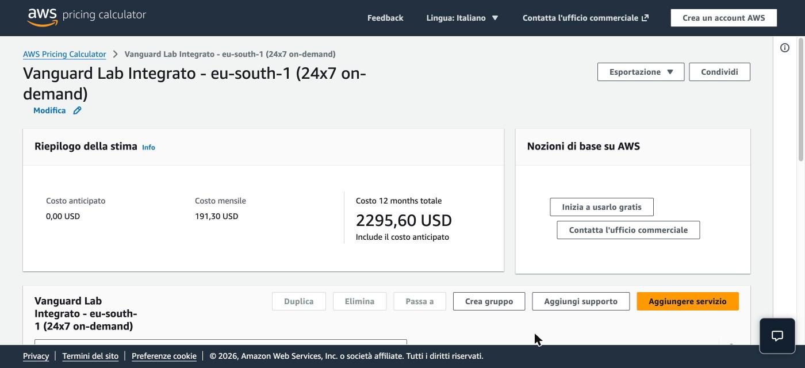
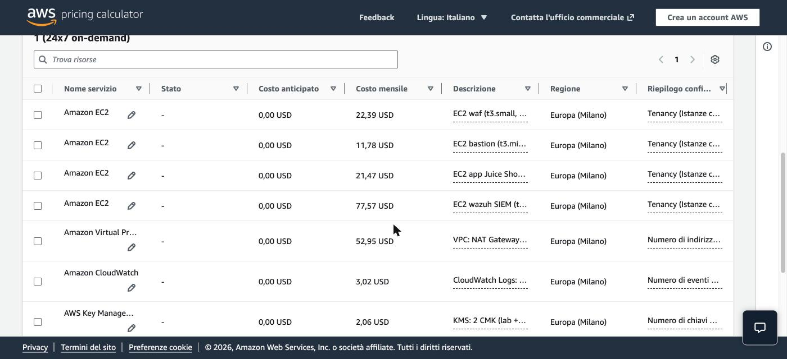

# Costi AWS dell'infrastruttura

Stima del 17/11/2026 fatta con l'**AWS Pricing Calculator** ufficiale. Regione **eu-south-1 (Milano)**, prezzi On-Demand in USD, tasse escluse.

- **Stima completa nel Calculator:** https://calculator.aws/#/estimate?id=ef836fcf0185d05366126fc600b21a586f6a0ee7
- L'infrastruttura non è ancora stata deployata: questi sono **costi stimati**, non addebiti reali.

## Costo mensile (acceso 24 ore su 24)

| Servizio | Configurazione (da Terraform) | Mensile | Annuale |
|---|---|---:|---:|
| EC2 `wazuh` | `t3.large`, disco gp3 60 GB | 77,57 | 930,84 |
| EC2 `waf` | `t3.small`, disco gp3 30 GB | 22,39 | 268,68 |
| EC2 `app` (Juice Shop) | `t3.small`, disco gp3 20 GB | 21,47 | 257,64 |
| EC2 `bastion` | `t3.micro`, disco gp3 10 GB | 11,78 | 141,36 |
| NAT Gateway | 1, circa 20 GB/mese di traffico | 37,50 | 450,00 |
| IP pubblici | 3 Elastic IP (NAT, waf, bastion) | 10,95 | 131,40 |
| Traffico in uscita | circa 50 GB/mese verso Internet | 4,50 | 54,00 |
| CloudWatch Logs | VPC Flow Logs, circa 5 GB/mese | 3,02 | 36,24 |
| KMS | 2 chiavi (lab e state Terraform) | 2,06 | 24,72 |
| S3 | bucket dello state Terraform e dei log | 0,06 | 0,72 |
| **Totale** | | **191,30** | **2.295,60** |

I costi EC2 comprendono il disco e il monitoraggio dettagliato (2,10 USD per VM). I servizi senza costo (VPC, subnet, security group, IAM) non sono in tabella.

## Logging e monitoraggio

Oggi il codice prevede VPC Flow Logs su CloudWatch e monitoraggio dettagliato delle 4 VM.

| Scenario | Flow Logs al mese | Costo mensile |
|---|---:|---:|
| Basso | 1 GB | 9,00 |
| Medio (usato nella stima) | 5 GB | 11,42 |
| Alto (molte scansioni del red team) | 25 GB | 23,52 |

CloudTrail e gli allarmi CloudWatch non sono configurati: aggiungerli costerebbe circa 1 USD/mese.

## Come risparmiare

| Modalità d'uso | Mensile | Su 3 anni |
|---|---:|---:|
| Tutto acceso 24 ore su 24 | 191,30 | 6.887 |
| Con Savings Plan EC2 di 3 anni (tutto anticipato) | 120,29 | 4.330 |
| VM spente fuori orario (10 h × 22 giorni) | 105,99 | 3.816 |
| **Stack distrutto fuori orario con `terraform destroy`** | **65,09** | **2.343** |

- **Consiglio principale:** creare lo stack `Mainterraform` solo durante le sessioni di lavoro e distruggerlo alla fine. NAT Gateway e IP pubblici si pagano anche con le VM spente, quindi spegnere le VM non basta.
- **Savings Plan:** conviene solo se il laboratorio resta acceso 24 ore su 24 per 3 anni. È un impegno che non si può annullare e si paga anche con le VM spente.
- Impostare un **AWS Budget** (i primi due sono gratuiti) con un avviso a 100 USD/mese.

## Ipotesi e limiti

- Il traffico e i volumi dei log sono stimati: non esistono ancora dati reali.
- Dopo il primo deploy, confrontare questa stima con Cost Explorer filtrando per il tag `Project`.
- `terraform.tfvars.example` e i workflow CI/CD usano ancora `us-east-1`: vanno allineati a `eu-south-1`.
